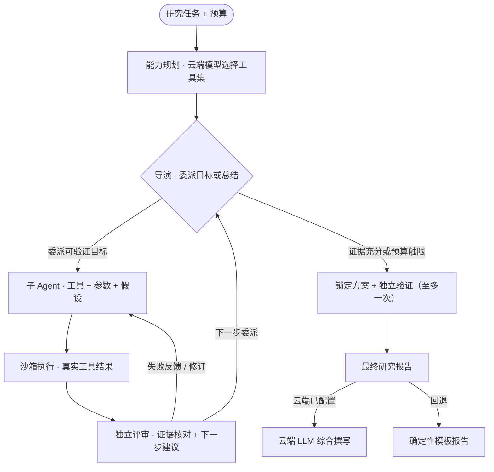

# LazyResearch

LazyResearch 是一个 **LLM 驱动的多领域研究 Agent 工作台**：把研究目标、数据和预算交给系统，模型在受控预算内提出可验证的假设、执行真实实验、接受独立评审并迭代修正，最后由云端大模型综合全部证据、研究对话与评审记录，撰写一份只引用实测数据的研究报告。

- **Web 工作台**：React/Vite 前端 + FastAPI 服务，实时进度、对话记忆、研究历史、报告下载与研究包导出。
- **通用研究引擎**：能力规划 → 导演 → 子 Agent → 独立评审的分层编排，SQLite 持久化全部决策、证据与预算账本。
- **真实计算**：数列验证、CPU 成员查询基准、CSV 分类、Favorita 销量预测基准、Top-K C++ 算子基准，以及 LLM 自行注册的沙箱 JS 工具。

## 架构特点

- **预算治理**：每次模型调用与实验都按 wall time / CPU / token / 费用 / 云端请求额度记账，超限即止；研究结束后生成报告仍受独立额度保护。
- **证据与解释分离**：工具实测分数写入 evidence，独立评审意见只写入 reviews，任何角色都不得改写实测结果；方案锁定后独立验证至多执行一次，避免自适应选择偏差。
- **多层 LLM 编排**：云端模型做能力规划与复杂诊断，本地小模型做常规委派决策；本地优先、复杂步骤云端优先，端点故障自动熔断。
- **两阶段工具注册**：`register_tool` 样例校验通过后只是「待验证」，必须用真实输入运行成功才正式注册；连续失败自动丢弃并引导修订。
- **反「执行→报错」循环**：连续失败计数、同工具失败封锁（blocked）、连续 3 次失败提前收尾；错误信息、评审建议与已试参数始终注入下一轮上下文。
- **沙箱与可复现**：JS 工具运行在 quickjs（16MB 内存、0.5s 限时）中，实验在限时子进程里执行；相同决策不重跑，模型调用按请求 ID 缓存，支持断点恢复与重放。
- **云端 LLM 最终研究报告**：研究结束后把实测证据、每轮假设、独立评审、研究对话（memory）与任务材料整体送给云端大模型撰写报告；云端不可用或调用失败时回退确定性模板，失败原因可见。



## 快速开始

### 环境要求

- CPython 3.11+（含 pip/venv）
- Node.js 20.19+ 或 22.12+（构建前端）
- （可选）[Ollama for Windows](https://ollama.com/download/windows) —— 使用本地小模型时需要
- 本地模型权重**不随仓库分发**：`-DeployLocalModel` 会从 Ollama 注册表自动拉取（详见 [models/README.md](models/README.md)）

### 一键部署

```powershell
# 1. 克隆仓库
git clone https://github.com/lierl1222/LazyResearch.git
cd LazyResearch

# 2. 准备配置（models.toml 已被 Git 忽略）
if (-not (Test-Path .\models.toml)) { Copy-Item .\models.example.toml .\models.toml }

# 3. 编辑 models.toml，至少启用一个模型端点（见下文「模型配置」）

# 4. 部署并启动（含本地模型时加 -DeployLocalModel）
powershell.exe -NoProfile -ExecutionPolicy RemoteSigned -File .\deploy.ps1 -DeployLocalModel -Port 8010
```

打开 <http://127.0.0.1:8010> 即可使用工作台。停止服务在启动终端按 Ctrl+C。

### 手动部署

```powershell
python -m venv .venv
.\.venv\Scripts\python.exe -m pip install -r requirements.txt
npm.cmd --prefix web ci
npm.cmd --prefix web run build
.\.venv\Scripts\python.exe -m uvicorn lazyresearch.api:create_app --factory --host 127.0.0.1 --port 8010
```

`deploy.ps1` 参数：

| 参数 | 用途 |
| --- | --- |
| `-Port 8010` | 监听端口，默认 8000 |
| `-DeployLocalModel` | 检查/启动 Ollama，按需导入本地权重（有完整权重文件时）或 `ollama pull` |
| `-SkipBuild` | 复用现有虚拟环境与前端产物，适合只改配置后重启 |
| `-PrepareOnly` | 只安装与构建，不启动服务 |
| `-ConfigPath <path>` | 指定 models.toml 路径 |
| `-Python <path>` | 指定首次建环境用的 CPython |

## 模型配置

编辑 `models.toml`（从 `models.example.toml` 复制）。本地与云端均为 OpenAI 兼容的 chat completions 端点：

```toml
[local]
enabled = true
base_url = "http://127.0.0.1:11434/v1"   # Ollama 默认地址
model = "qwen2.5:1.5b"
max_output_tokens = 1024
output_limit_field = "max_tokens"

[cloud]
enabled = true
base_url = "https://api.deepseek.com"
model = "deepseek-v4-pro"
api_key = ""                              # 留空则读取下方环境变量
api_key_env = "LAZYRESEARCH_CLOUD_API_KEY"
max_output_tokens = 512
output_limit_field = "max_tokens"
json_output = true                        # 供应商支持 JSON 输出时开启
disable_thinking = true

[prompts]
planning = "根据研究目标、工具和预算，制定包含证据收集、候选验证和失败修正的可验证计划。"
local = "根据研究计划、现有证据和上一轮验证结果，从给定候选中选择最值得优先执行的一项。"
```

- **密钥安全**：优先使用 `api_key_env` 指定的环境变量，不要在仓库中保存明文密钥；`models.toml` 已被 Git 忽略。
- **预算**：任务可限制云端请求次数、LLM 调用数、输入/输出 token、实验次数、运行时间、CPU 秒与 API 费用上限；Web 端在「预算配置」面板设置，CLI 任务 JSON 使用 `budget` 字段。
- 只配置本地模型可完成常规研究（决策由本地模型完成）；云端模型负责能力规划、复杂诊断与最终研究报告。

## 使用

### Web 工作台

1. 在首页输入研究目标（可上传 CSV 等附件），设置预算后点「研究」；
2. 实时查看规划、委派、实验、验证与修正进度；每轮实验都有独立评审意见；
3. 任务结束后页面展示研究报告（云端 LLM 撰写或确定性模板），可下载 `result.md` 与完整研究包（决策、事件、实验 JSON）；
4. 在同一窗口继续输入目标即可**延续研究**：新运行会继承附件、参考上一轮结果与当前对话记忆；「对话」用本地模型按阶段回答；「新建研究」开启独立窗口。

### CLI

```powershell
# 通用研究引擎：研究任务 JSON + 模型配置
.\.venv\Scripts\python.exe -m lazyresearch research --task configs/research-sequence.json --model-config models.toml
```

任务 JSON 的 `goal` 是研究目标，可同时提供多种材料：

| 字段 | 研究类型 |
| --- | --- |
| `sequence` | 整数数列：验证多项式等假说 |
| `cpu_benchmark` | CPU 成员查询基准（正确性 + 计时对比） |
| `csv_text` / `tabular` | CSV 二分类研究（Web 上传） |
| Favorita 数据包 | 销量预测：开发折选参 + 独立验证，产出 submission.csv |
| Top-K 数据包 | C++ Top-K 算子：隔离 GCC 编译回测（正确性 + 加速比） |

运行结束打印 report.json 路径；`registry.sqlite` 保存任务、决策、执行与预算账本，`workers/` 保存独立进程的原始结果。

### 研究报告

- 云端模型可用且存在有效实测证据时，报告由云端大模型撰写：输入包含**全部实测证据、每轮假设与评审、研究对话记忆、任务材料、预算摘要**；输出为「摘要 / 问题与数据 / 方法 / 实验结果 / 分析 / 优缺点 / 结论与建议」的技术报告。
- 报告只允许引用实测数字，未执行的实验、未做显著性检验的「显著」结论、待验证工具均会被指令禁止；云端失败时回退确定性模板，并在运行记录中显示回退原因。

## 扩展研究工具

每次研究启动时读取 [configs/tools.toml](configs/tools.toml)，按任务材料筛选可用工具。新增一个工具：

1. 在 [lazyresearch/tools](lazyresearch/tools) 下新建 Python 模块，定义 Pydantic 参数模型与 `(root, task, args) -> dict` 的函数；
2. 在 `configs/tools.toml` 登记：

```toml
[tools.my_check]
material = "csv_files"
label = "自定义 CSV 检查"
purpose = "说明工具需要的输入和可验证的输出。"
module = "my_check"
schema = "Arguments"
function = "run"
```

`material` 使用任务材料标记（`csv_files`、`sequence`、`domain` 等）。研究过程中 LLM 也可以调用内置的 `register_tool` 注册任务级 JS 工具：样例校验通过后须经真实输入运行验证才会正式生效。

## 测试与排障

```powershell
.\.venv\Scripts\python.exe -m unittest discover -s tests -v   # 或 pytest tests/
npm.cmd --prefix web run build
```

| 现象 | 排查步骤 |
| --- | --- |
| PowerShell 禁止运行脚本 | 使用 README 中的进程级启动命令；或 `Get-ExecutionPolicy -List` 查看组策略 |
| 找不到 `ollama` | 安装 Ollama 并重新打开终端，运行 `ollama --version` |
| 端口已占用 | 停止原服务，或传入空闲 `-Port` |
| 云端已配置但任务未调用 | 检查任务云请求/token 预算、`prompts.planning`，以及事件中的预留额度与错误 |
| 研究报告是模板版 | 运行记录会显示「云端报告生成未完成：<原因>」，按原因排查（配额、超时、输出过短等） |
| 本地模型无调用记录 | 检查 Ollama 服务与 `ollama list`、`prompts.local` 是否填写 |

运行状态默认保存在 `.lazyresearch/`（Web 可用 `LAZYRESEARCH_DIR` 指定）。升级前停止服务并备份状态目录。

## 目录结构

```
lazyresearch/          # 研究引擎与服务
  research.py          # 通用研究编排（能力规划/导演/子 Agent/反循环控制）
  forecast_search.py   # Favorita 预测参数搜索
  research_review.py   # 独立评审
  final_report.py      # 云端 LLM 最终研究报告
  results.py           # 确定性报告模板（回退路径）
  science/             # 预算治理、隔离执行、模型网关、表格科研 CLI
  tools/               # 内置研究工具（含沙箱 JS 注册工具）
web/                   # React/Vite 工作台前端
configs/               # 工具注册表与研究任务示例
deploy.ps1             # Windows 一键部署脚本
docs/                  # 架构与验收文档
models/                # 本地模型导入说明（不含权重）
```

## 安全与数据边界

- 密钥只通过环境变量或 gitignored 的 `models.toml` 提供，仓库不包含任何密钥；请勿将真实 API key 提交到 Git。
- 最终研究报告会把研究证据、对话记录与任务材料发送到**你配置的云端端点**。任务材料与历史对话在报告提示词中被标记为不可信数据，其中的指令会被要求忽略；如数据敏感，建议只配置本地模型（此时报告回退确定性模板，不发送云端）。
- 实验与 LLM 注册的工具代码均在本地沙箱中执行，不接触宿主文件系统以外的能力。

## 许可证

项目代码的许可证尚未确定。`models/LICENSE` 仅适用于其引用的 Qwen 模型文件（Apache 2.0），不覆盖仓库其余内容。上游参考见 [docs/RESEARCH_ARCHITECTURE.md](docs/RESEARCH_ARCHITECTURE.md) 的编排参考一节。
