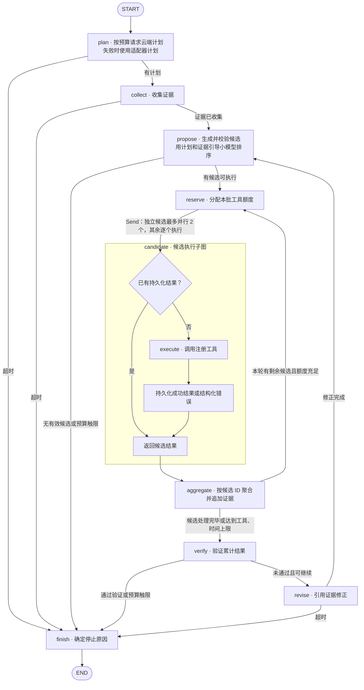

# LazyResearch

LazyResearch 是面向研究场景的本地工作台。LangGraph 编排规划、证据收集、假设、实验、验证与修正，FastAPI 提供运行接口，React/Vite 提供工作台，SQLite 保存运行状态和检查点。当前默认适配器提供可重复的研究闭环，用于验证编排、模型接入与预算控制。

## 运行模式

### 表格研究 G0 / P0

业务任务书见 [RESEARCH_AGENT_GOALS.md](docs/RESEARCH_AGENT_GOALS.md)，融合范围见 [P0_IMPLEMENTATION.md](docs/P0_IMPLEMENTATION.md)。科学研究入口支持 CSV/Parquet 二分类、训练集 EDA、真实基线、可证伪假设、受控实验、统计审查、反馈迭代与一次性封存测试。现有 Web 保留通用 fixture 工作台；表格研究通过 CLI 和 JSON/Markdown 报告交付，Streamlit 迁移属于 P1。

```powershell
powershell.exe -NoProfile -ExecutionPolicy RemoteSigned -File .\deploy-research.ps1
```

脚本安装 Python 依赖、生成离线合成数据并运行 Mock 研究决策与真实科学计算，不需要 Node.js、GPU 或云密钥。产物位于新建的 `runs/<run_id>/`；Mock 模式不会被标为真实 LLM 研究成果。详见 [表格研究部署与复现](docs/SCIENCE_DEPLOYMENT.md) 和 [角色工作流](docs/SCIENCE_WORKFLOW.md)。验收证据与双模型冒烟见 [终验收报告](docs/P0_ACCEPTANCE_REPORT.md)（云端规划 + 本地候选排序冒烟已通过），进度与验证记录见 [PROGRESS.md](PROGRESS.md)。

| 模式 | 配置 | 执行方式 |
| --- | --- | --- |
| 本地规则 | 保持模板默认值 | 适配器完成全部流程，便于验证部署 |
| 本地模型 | 启用 `[local]` 和 `prompts.local` | Qwen 根据计划和证据对多个候选排序 |
| 云端规划与本地执行 | 同时启用本地模型和 `[cloud]`，配置 `prompts.planning` | 云模型生成结构化计划，小模型辅助排序，适配器执行、验证和修正 |

部署拓扑为单台 Windows 主机上的单进程服务，应用默认监听回环地址。本地 Ollama 独立运行，云 API 只在启用且任务预算允许时调用。

## 1. 准备环境与代码

- CPython 3.11+，以及 Node.js 20.19+ 或 22.12+。
- Git 和 Git LFS。使用本地 Qwen 时安装 [Ollama for Windows](https://ollama.com/download/windows)。
- 首次安装依赖和获取 LFS 对象需要网络。随仓库分发的 GGUF 约 1.12 GB，Ollama 导入时还会写入自己的模型缓存。

```powershell
git lfs install
git clone https://github.com/lierl1222/LazyResearch.git
cd LazyResearch
git lfs pull
git lfs ls-files
```

确认 [models 目录](models/README.md) 中的 GGUF 为完整文件。部署脚本会在导入前校验 SHA-256。已通过 Git 获取完整权重时，Ollama 无需再次下载模型。

## 2. 配置模型

```powershell
if (-not (Test-Path .\models.toml)) {
    Copy-Item .\models.example.toml .\models.toml
}
```

编辑本地 `models.toml`。保持模板默认值即可先验证规则模式。下例展示 Qwen 与 DeepSeek 的组合，替换模型 ID 和密钥后启用。

```toml
[local]
enabled = true
base_url = "http://127.0.0.1:11434/v1"
model = "qwen2.5:1.5b"
timeout_seconds = 30
max_output_tokens = 128
output_limit_field = "max_tokens"

[cloud]
enabled = true
base_url = "https://api.deepseek.com"
model = "<供应商提供的模型 ID>"
api_key = "<云 API key>"
api_key_env = "LAZYRESEARCH_CLOUD_API_KEY"
timeout_seconds = 30
max_output_tokens = 256
output_limit_field = "max_tokens"
json_output = true
disable_thinking = true

[prompts]
local = "根据计划、证据和验证结果，选择最值得优先执行的候选。"
planning = "根据目标、工具和预算制定简短的研究计划，涵盖证据收集、验证与修正。"
diagnosis = ""
```

- `base_url` 填 API 根地址，网关自动追加 `/chat/completions`。示例中的 JSON 输出和推理开关适用于 DeepSeek，使用其他供应商时按其接口能力配置。 [DeepSeek Chat Completions 文档](https://api-docs.deepseek.com/api/create-chat-completion/)
- 密钥优先读取 `cloud.api_key`，留空时读取 `cloud.api_key_env` 指定的环境变量。部署脚本会在进程变量为空时检查 Windows 用户环境变量。`models.toml` 已被 Git 忽略，模板应只保留占位内容。
- Ollama 导入后的模型缓存默认在 `%USERPROFILE%\.ollama\models`，可通过 `OLLAMA_MODELS` 调整。使用其他本地兼容端点时先独立启动该服务，再填写地址和模型 ID。 [Ollama Windows 文档](https://docs.ollama.com/windows)
- Web 和 CLI 默认读取当前目录下的 `models.toml`，可通过 `LAZYRESEARCH_MODEL_CONFIG` 指定路径。部署脚本另支持 `-ConfigPath`，CLI 支持 `--model-config`。保存修改后重启服务。

## 3. 启动与更新

在仓库根目录运行。命令中的 `RemoteSigned` 只作用于本次 PowerShell 进程。 [Microsoft PowerShell 执行策略](https://learn.microsoft.com/en-us/powershell/module/microsoft.powershell.core/about/about_execution_policies)

```powershell
powershell.exe -NoProfile -ExecutionPolicy RemoteSigned -File .\deploy.ps1 -DeployLocalModel -Port 8010
```

脚本会检查端口与 Ollama，创建或复用 `.venv`，安装 Python 依赖，执行 `npm ci` 和前端构建，校验并按需导入 Qwen，最后前台启动 Uvicorn。使用规则模式或已经独立管理的兼容推理服务时，可省略 `-DeployLocalModel`。打开 [工作台](http://127.0.0.1:8010)，在启动终端按 Ctrl+C 停止服务。

| 参数 | 用途 |
| --- | --- |
| `-Port 8010` | 指定监听端口，省略时默认 8000 |
| `-DeployLocalModel` | 检查或启动本机 Ollama，按需导入随附 Qwen |
| `-SkipBuild` | 复用现有虚拟环境和前端产物，适合只改配置后重启 |
| `-PrepareOnly` | 安装、构建并按参数准备模型，随后退出 |
| `-Python 'C:\path\to\python.exe'` | 首次建环境时指定 CPython |
| `-ConfigPath 'C:\path\to\models.toml'` | 选择本次部署的配置文件 |

更新代码或依赖时，停止服务后拉取代码和 LFS 对象，重新执行完整启动命令。只修改模型配置时，可在启动命令中追加 `-SkipBuild`。

手动启动可使用以下命令，模型服务由操作者单独准备。

```powershell
python -m venv .venv
.\.venv\Scripts\python.exe -m pip install -r requirements.txt
npm.cmd --prefix web ci
npm.cmd --prefix web run build
.\.venv\Scripts\python.exe -m uvicorn lazyresearch.api:create_app --factory --host 127.0.0.1 --port 8010
```

## 4. 部署验收

1. 访问 [工作台](http://127.0.0.1:8010) 和 [配置接口](http://127.0.0.1:8010/config)。双模型部署应显示 `models.local.ready` 与 `models.cloud.ready` 均为 `true`。该状态反映配置就绪，实际连通性由任务验证。
2. 在界面提交任务「验证首轮失败后能否依据证据修正并通过下一轮」。使用测试适配器，云请求设为 1，token 预算可先填 6000，再按供应商和 Prompt 调整。规则模式保持云预算为 0。
3. 双模型运行应看到「云端研究计划」「小模型选择优先候选」以及第二轮验证通过。刷新页面应能回放进度，完成后下载研究包，核对报告、证据、运行记录及复跑配置。云端计划未通过格式校验或超预算时，事件中会显示回退原因。

```powershell
.\.venv\Scripts\python.exe -m unittest discover -s tests -v
npm.cmd --prefix web run build
```

历史真实双模型冒烟已验证 DeepSeek 生成的计划被采用，Qwen 完成候选排序，研究任务在第二轮通过。该次运行云端 1 次、231 token，本地 1 次、229 token。此数据用于确认部署链路。

## 5. 运行维护与排查

| 现象 | 排查步骤 |
| --- | --- |
| PowerShell 报禁止运行脚本 | 使用上面的进程级启动命令。若仍被拦截，运行 `Get-ExecutionPolicy -List` 查看组策略 |
| 找不到 `ollama` | 确认已安装并重新打开终端，运行 `ollama --version`。脚本也会检查默认安装目录 |
| 模型文件只有很小的文本内容 | 执行 `git lfs pull`，确认权重文件已完整下载 |
| 端口已占用 | 停止原工作台，或传入空闲的 `-Port` 并改用对应地址 |
| 云端就绪但任务未调用 | 检查任务云请求和 token 预算、计划 Prompt，以及事件中的预留额度或错误 |
| 小模型无调用记录 | 检查 Ollama 服务、`ollama list`、本地 Prompt 和当轮是否有多个候选 |

运行状态默认保存在 `.lazyresearch/`。Web 用 `LAZYRESEARCH_DIR`，CLI 用 `--state-dir` 指定目录。每个状态目录由一个服务实例管理。升级前停止服务并备份状态目录，恢复时使用原配置和适配器。CLI 支持新建、复跑与恢复。

```powershell
.\.venv\Scripts\python.exe -m lazyresearch --goal "验证研究闭环" --output .lazyresearch\report.zip
.\.venv\Scripts\python.exe -m lazyresearch --task task.json
.\.venv\Scripts\python.exe -m lazyresearch --resume <run-id>
```

`task.json` 来自解压后的研究包。同一配置下复跑会创建新任务，启用模型时可再次调用。恢复则从已有检查点继续，并复用已落盘的候选结果。

## API 与扩展

| 接口 | 用途 |
| --- | --- |
| `GET /config` | 返回适配器和模型配置就绪状态 |
| `POST /runs` | 创建研究任务 |
| `GET /runs/{id}` | 获取任务快照 |
| `GET /runs/{id}/events` | SSE 事件流，支持 `Last-Event-ID` 回放 |
| `GET /runs/{id}/artifacts` | 下载研究包 |

- 通过 [ResearchAdapter](lazyresearch/adapters.py) 定义工具、证据和验证标准。通过 `Runner(adapters=...)` 注册适配器。工具需遵守传入的时限，并用操作 ID 保证重试幂等。到达时限时运行器停止等待。
- 通过 [ModelGateway](lazyresearch/model_gateway.py) 接入兼容供应商。网关负责请求、用量与保守 token 预估。自定义 `Runner` 可传入 `create_app(runner=...)`。

## LangGraph 编排流程图

下图对应 [工作流源码](lazyresearch/workflow.py)。主图有两条回路。同一轮内可继续派发候选，验证后可依据证据修正并开启下一轮。



**云端规划**位于 `plan` 节点。配置了规划 Prompt 和云网关时，先检查云请求额度、token、时间和工具额度，再请求带概要及步骤的结构化计划。计划传入证据收集，并随候选与验证反馈交给小模型。云计划不可用时沿用适配器计划。启用云规划的任务最多请求一次云模型，后续验证与修正由本地流程完成。默认 Prompt 为空，真实云请求额度为 0。

**本地小模型**也在 `propose` 内运行。仍有多个候选且小模型已配置时，尝试提升一个独立候选的执行优先级。调用失败时保留候选原顺序。本地用量单独记录。

**恢复与导出**由 [Runner](lazyresearch/runner.py) 管理。运行 ID 对应 SQLite 中的 LangGraph `thread_id`。中断后从检查点继续，已落盘的候选结果直接复用。主图结束后保存最终快照，供 CLI 和 Web 导出报告、证据及复跑配置。

## 编排参考

参考 [agentic-rag-for-dummies @ c1b339b](https://github.com/GiovanniPasq/agentic-rag-for-dummies/tree/c1b339b54f0927bd0b469fcce70f3cd5de4e918d/project/rag_agent) 的主图和子图分工、条件边与 `Send` 聚合。参考源码通过独立的稀疏检出对照。LazyResearch 用结构化证据连接阶段，并使用本地报告节点在预算耗尽时收尾。
