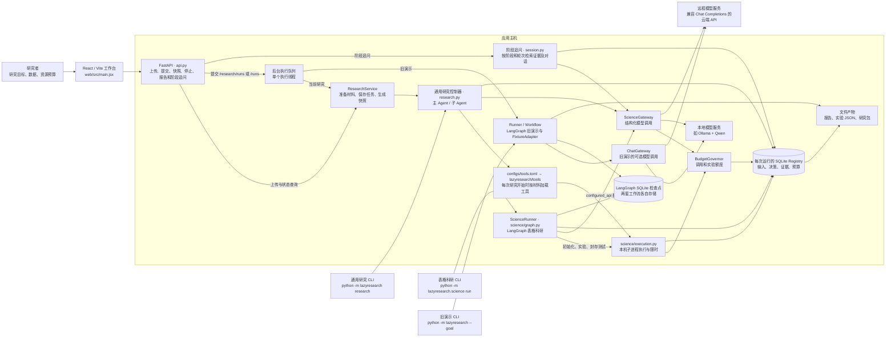
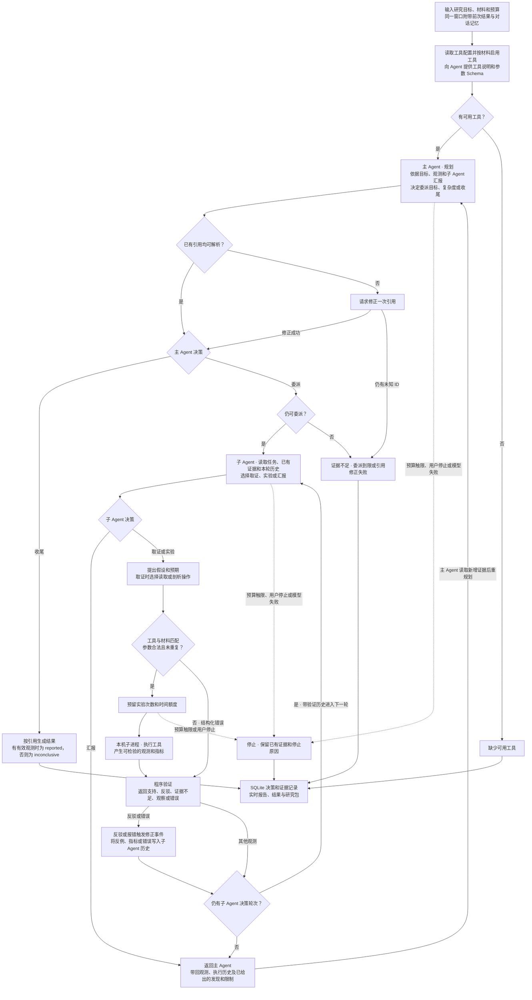
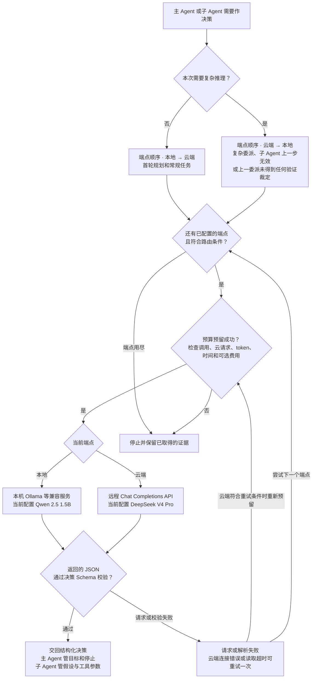

# LazyResearch 架构与赛题对应

## 1. 当前代码架构

| 路径 | 编排与模型职责 | 产物与恢复 |
| --- | --- | --- |
| **当前 Web 与通用 CLI** | `/research/runs` 和 `python -m lazyresearch research` 共用 `research()`。Python 控制委派与实验轮次，主、子 Agent 各自发出结构化决策。 | Web 每秒查询快照，可按阶段和轮次使用本地模型追问、停止及下载研究包。同一窗口可连续研究并引用前次结果，使用独立的窗口记忆。服务重启时重新调度排队任务，已中断的运行标记为停止。通用 CLI 每次使用新运行目录。 |
| **独立表格科研 CLI** | `ScienceRunner` 使用 LangGraph。Mock 模式按规则决策并运行真实实验。API 模式由云端对预定义假设卡排序，后续按审查反馈向本地或云端请求选择。 | 每个运行目录保存 Registry、LangGraph 检查点、统计审查、模型和报告。支持 `resume` 和复现实验。 |
| **旧演示 API / CLI** | `/runs`、旧 CLI 由 `Runner` 和 `Workflow` 驱动。默认规则适配器，可选云端规划和本地候选排序。 | 保存工作流检查点及候选结果，支持恢复、SSE 回放与导出。 |

入口源码见 [Web](../web/src/main.jsx)、[FastAPI](../lazyresearch/api.py)、[研究服务](../lazyresearch/research_service.py)、[通用控制器](../lazyresearch/research.py)、[表格科研图](../lazyresearch/science/graph.py) 和 [旧演示图](../lazyresearch/workflow.py)。

## 2. 当前 Web 与通用 CLI 的 Agent 研究闭环

**证据来自给定材料与注册工具。** 子 Agent 可先读附件片段或检查 CSV 的列与缺失值，再选择实验。工作台的阶段视图将取证归入工具执行和验证。实验记录以观测 ID 回到子 Agent，主 Agent 收尾时检查引用是否存在。合法 ID 可以对应反证或证据不足，`reported` 表示已提交有观测引用的结论，结论支持范围由原始验证记录界定。 [控制器](../lazyresearch/research.py) · [工具注册表](../lazyresearch/research_tools.py) · [阶段视图](../lazyresearch/session.py)

| 给定材料 | 可执行证据与验证 |
| --- | --- |
| 整数数列 | 对给定下标逐点检查多项式，失败时给出首个反例。结论范围限于已提供的下标。 |
| CPU 成员查询 | 同一随机种子生成工作负载，先校验答案与列表基线一致，再交替测量七组耗时，以中位数计算加速比。 |
| CSV 二分类 | 先检查表结构，再指定目标列。候选与逻辑回归基线使用同一划分，验证集上的指标与统计审查支持探索性结论。 |
| 时间序列或 Favorita 数据包 | 按时间切分，与季节朴素基线比较。完整 Favorita 包进入有预算约束的搜索，决策 Agent 根据同一开发折的 RMSLE 选择新参数，锁定实测最低分后才在后续留出折评估并生成 `submission.csv`。 |

相关实现见 [工具及验证](../lazyresearch/research_tools.py)、[时间序列回测](../lazyresearch/forecast.py) 和 [Favorita 基准](../lazyresearch/favorita_benchmark.py)。

## 3. 通用 Agent 的本地与云端模型路由

- **部署与职责。** 当前工作区的 `models.toml` 启用了本地 Ollama 的 `qwen2.5:1.5b` 和云端 `deepseek-v4-pro`。模型 ID 取自配置。只有一个端点时，在其可用且预算允许的情况下由它承担两种 Agent 的推理。Web 的就绪标记检查配置字段，实际请求结果由运行记录确认。 [配置加载](../lazyresearch/configuration.py) · [研究配置接口](../lazyresearch/api.py) · [模型路由](../lazyresearch/research.py)
- **升级与回退。** 主 Agent 在上一委派没有产生验证裁定时优先请求云端。子 Agent 在委派标为复杂或上一步含执行错误时优先请求云端。云请求额度已用尽时，端点选择会跳过云端。网关预算预留被拒绝时进入停止路径。 [模型路由](../lazyresearch/research.py) · [预算账本](../lazyresearch/science/budget.py)
- **同一预算账本。** 网关发请求前按输入估计和输出上限预留，用供应商实际用量结算，缺失时保留预留记录。工具执行前预留实验额度，并按剩余 CPU 时间、总时间和单次时限限制子进程。任务停止或超时时，网关可取消请求，执行器可终止子进程。Favorita 搜索的每个候选和最终独立验证分别计一次实验。 [模型网关](../lazyresearch/science/gateway.py) · [预算账本](../lazyresearch/science/budget.py) · [子进程执行器](../lazyresearch/science/execution.py)
- **模型输入边界。** 实验执行及原始附件保存于本机。调用云端时，请求可包含用户目标、工具目录、观测指标、已提取的附件片段及近期问答。阶段追问也使用同一预算账本，按阶段、轮次和关键词检索上下文，并优先尝试本地端点。 [通用控制器](../lazyresearch/research.py) · [材料读取](../lazyresearch/research_tools.py) · [会话上下文](../lazyresearch/session.py)

## 4. 独立表格科研 CLI 的 LangGraph 闭环

```mermaid
flowchart LR
    Input["CSV / Parquet + YAML"]
    Init["DataScientist<br/>训练集 EDA、固定切分、检查禁用字段"]
    Baseline["真实基线<br/>Dummy 与 Logistic Regression"]
    Hyp["HypothesisScientist<br/>根据证据生成可证伪假设卡"]
    Cloud["云模型 · API 模式<br/>筛选与排序已有假设 ID"]
    Engineer["AlgorithmEngineer<br/>生成受控实验规格"]
    Run["本机子进程<br/>训练与固定验证集评估"]
    Review["ScientificReviewer<br/>比较基线并评估不确定性"]
    Director["ResearchDirector<br/>结合裁定、停滞、目标和预算决策"]
    Select["可选模型选择下一张假设卡<br/>常规走本地，停滞至少两轮走云端<br/>失败时沿用规则决策"]
    Freeze["锁定验证集 AP 最优的有效候选"]
    Test["预算与数据允许时<br/>执行一次封存测试"]
    Export["导出报告<br/>记录实验、统计裁定、预算及跳过原因"]

    Input --> Init --> Baseline --> Hyp
    Hyp -->|"Mock 或允许的规划回退"| Engineer
    Hyp -->|"configured_api"| Cloud
    Cloud -->|"有效计划"| Engineer
    Cloud -->|"允许回退时使用规则计划"| Engineer
    Cloud -->|"不可继续"| Freeze
    Engineer --> Run --> Review --> Director
    Director -->|"继续"| Select --> Engineer
    Director -->|"停止"| Freeze
    Init -.->|"预算或数据条件触发停止"| Freeze
    Baseline -.->|"预算触限或基线失败"| Freeze
    Run -.->|"预算触限"| Freeze
    Freeze -->|"有有效候选且有额度"| Test --> Export
    Freeze -->|"无有效候选或测试额度不足"| Export
```

该 CLI 的候选选择和审查使用验证集，测试集留到最终评估。通用 Web 路径的 CSV 二分类工具复用数据处理、实验和统计审查组件，输出探索性验证结果。 [表格科研图](../lazyresearch/science/graph.py) · [科研角色](../lazyresearch/science/agents.py) · [通用表格工具](../lazyresearch/research_tools.py)

## 5. 对 Research Agent 赛题的优势

| 赛题考点 | 当前架构的优势 | 答辩可展示的证据 |
| --- | --- | --- |
| 自主完成研究闭环 | 主 Agent 决定委派与停止，子 Agent 依据观测选择工具和下一步。同一任务可经历重新试验与重新规划。 | 一条从计划、假设、实验和反例到下一轮修正的事件链。 [控制器回归测试](../tests/test_research_controller.py) |
| 在给定数据和工具下研究 | 按材料启用工具，参数经 Schema 校验，同一运行拒绝重复的工具与参数组合。实验在本机子进程中执行，指标由工具计算。 | 一条假设、一次工具请求、对应的原始结果和观测 ID。 [Web 研究接口测试](../tests/test_research_api.py) |
| 控制有限资源 | 模型与实验共用账本。常规推理优先本地，复杂或停滞时可优先使用云端。预算触限或用户停止时可以带已有证据结束。 | 预算快照、按端点分组的用量和停止原因。路由带来的节省需在同任务、同预算条件下测量。 [预算测试](../tests/test_science_budget.py) |
| 验证与反证 | 数列检查反例，CPU 基准同时检查正确性和速度，表格与时间序列有同协议基线。独立表格科研 CLI 还可展示封存测试。 | 展示一次失败候选或对照结果，以及验证所覆盖的数据范围。 [时间切分测试](../tests/test_forecast_upload.py) · [表格科研循环测试](../tests/test_science_loop.py) |
| 结论可审计 | 报告保留观测 ID、模型决策、实验原始记录和预算。评委可按阶段或轮次追问，沿记录核对结论与证据。 | 从 `result.md` 的观测 ID 追到 `workers/`、`events.json` 和 `model_calls.json`。 [研究包导出](../lazyresearch/research_service.py) · [会话测试](../tests/test_session_memory.py) |

架构证据可说明系统如何自主运行、控制成本和验证结论。研究质量、总成本与完成时间的相对收益需要用相同任务和预算进行对照评测。现有工具覆盖任务内材料与本机实验，跨任务记忆和通用网络检索未接入这条主链路。
