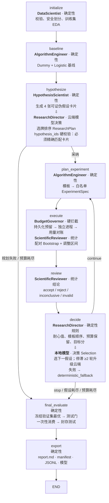

# 角色化表格研究工作流

任一节点返回 `stop_reason` 都经条件边进入 final_evaluate（交付已有成果），图中仅标注主要失败路径。LangGraph 管理循环与 checkpoint，SQLite Registry 是研究记录及预算的权威来源，JSONL 是审计导出。角色是职责划分，不是每步固定调用模型；BudgetGovernor 和科学计算完全是确定性代码。Mock 模式以受控策略替代模型决策，实验仍真实执行。

研究实验顺序执行，使后续决策能引用最新证据，并避免 CPU 和 Token 预留竞争。原 fixture 主图的独立候选并行仍保留；科学研究没有为追求“多 Agent”数量而引入没有证据收益的并行调用。

恢复时沿用已完成实验；已开始但结果不明的操作不自动重复。最终测试消费标记先于测试读取；报告导出不触发训练或额外收费调用。
